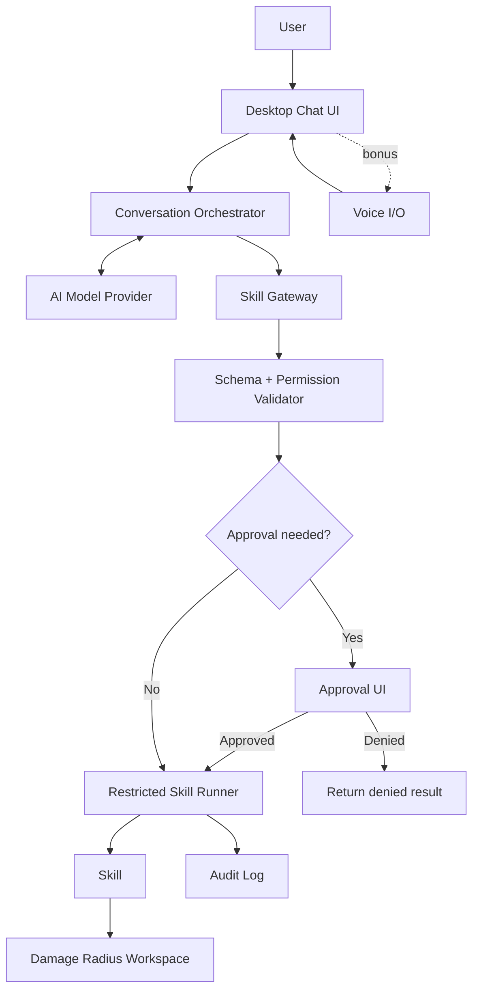

# Technical Design and Architecture

## Overview

The desktop client handles chat and user approvals. A conversation orchestrator communicates with the selected AI model. Model tool calls are untrusted proposals: a separate skill gateway validates them and checks permissions before a restricted runner executes a skill. The runner receives only the Damage Radius workspace and minimum declared capabilities.

## Architecture

## Trust boundaries

1. Model output cannot grant permissions or bypass the gateway.
2. Skill metadata declares requested capabilities; it does not grant them.
3. The runner enforces isolation and resource limits.
4. The host machine remains outside the Damage Radius.

## Components

| Component | Responsibility |
|---|---|
| Desktop UI | Chat, approvals, settings, microphone state |
| Orchestrator | Conversation state and tool routing |
| Provider adapter | AI model API integration |
| Skill registry | Approved skill metadata and schemas |
| Skill gateway | Argument validation and permission checks |
| Restricted runner | Sandboxed skill execution |
| Workspace manager | Damage Radius setup |
| Audit logger | Redacted invocation and outcome records |
| Voice adapter | Speech-to-text, text-to-speech, wake word |

## Skill execution flow

1. User sends a request.
2. Orchestrator asks the model for a response.
3. Model may return a structured request for a registered skill.
4. Gateway validates the skill ID and input schema.
5. Policy engine checks granted permissions and approval requirements.
6. Runner executes the skill with restricted access.
7. Result is validated, logged, and returned to the conversation.

## Damage Radius enforcement

A folder name is not a security sandbox. Use a dedicated low-privilege process/container with only the workspace exposed, no host home-directory mount, and network disabled by default. Test the mechanism on the target OS. If isolation cannot be established, do not execute the skill.

Suggested initial skills: `workspace_list`, `workspace_search`, `note_create`, and optionally `file_summarize`. Do not provide arbitrary shell execution.

## Voice bonus

Speech input becomes ordinary user text and goes through the same orchestrator, skill gateway, approval UI, and sandbox. Voice does not receive additional permissions. See [voice/VOICE.md](../voice/VOICE.md).

## Open decisions

- Target OS and desktop framework.
- Model provider or local model.
- Platform sandbox implementation.
- Skill packaging format.
- Speech provider and local wake-word engine.
