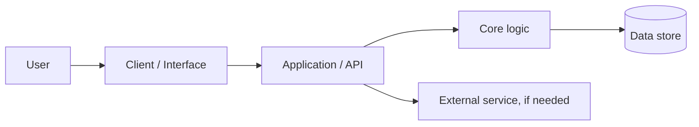

# Technical Design and Architecture

## Overview

[Explain the proposed system in a few sentences.]

## Architecture diagram

Add a diagram in `design/diagrams/` and link it here.

Replace this example with the actual design. Do not add components that the project does not need.

## Components

| Component | Responsibility | Technology | Owner |
|---|---|---|---|
| [Component] | [Responsibility] | [Technology] | [Person] |

## Main data flow

1. [User action]
2. [System processing]
3. [Data/API interaction]
4. [Result shown to user]

## Key technical decisions

| Decision | Chosen approach | Alternatives considered | Reason |
|---|---|---|---|
| [Decision] | [Choice] | [Alternatives] | [Reason] |

## Risks and failure modes

- [Dependency/API outage] → [Fallback]
- [Invalid input] → [Handling]
- [Data/privacy risk] → [Mitigation]

## Local development

See [setup.md](../docs/setup.md).
