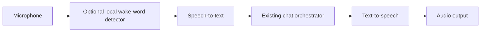

# Voice API and Wake-Word Bonus

## Goal

Allow the user to speak to the desktop assistant and hear spoken responses, while preserving the exact same security and permission model as text chat.

## Voice pipeline

## Features

### Speech input
- Push-to-talk is the simplest reliable baseline.
- Optional wake-word detection can activate speech capture.
- Convert speech to text, show the transcript, and let the user cancel or edit it before sending if practical.

### Speech output
- Read assistant responses aloud using a text-to-speech API or local engine.
- Provide stop/pause controls.
- Do not speak sensitive content automatically when the user has not enabled it.

### Wake word
- Prefer local wake-word detection so raw microphone audio is not continuously sent to a cloud API.
- Make the wake phrase configurable if the selected engine supports it.
- Show a clear listening indicator.
- Provide a persistent mute/disable control.
- Avoid storing raw audio by default.

## Security invariants

Voice is only another input/output method. A spoken request must not gain permissions that a typed request would not have. All skill requests still pass through the same gateway, approval UI, Damage Radius runner, and audit log.

## Provider decision

Choose a speech-to-text and text-to-speech provider after checking:
- Supported OS and languages.
- Streaming latency and reliability.
- Cost and rate limits.
- Audio retention and training policy.
- Whether a local/offline option is feasible.

Do not commit provider keys. Keep credentials in protected app configuration or OS credential storage.

## Demo acceptance

- [ ] User can start/stop recording explicitly.
- [ ] Speech is transcribed and submitted to the normal chat flow.
- [ ] Assistant response can be spoken aloud.
- [ ] User can interrupt speech output.
- [ ] Wake-word activation works if implemented.
- [ ] Microphone state is visible and can be disabled.
- [ ] No voice path bypasses skill permissions or approval.
